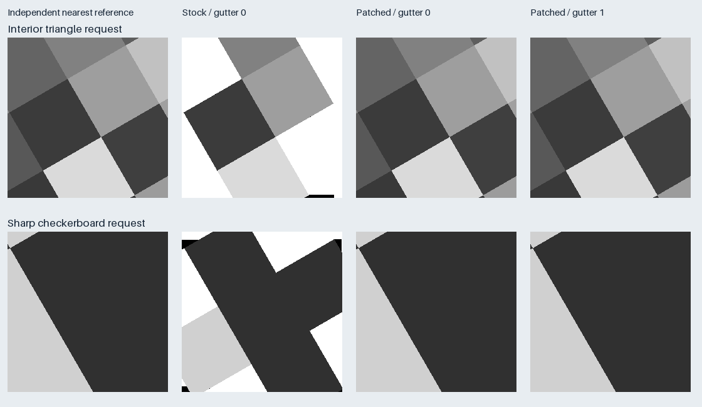

# Kartoza 2.28.5 validation results

Tested on 2026-10-20 using the unchanged stock Kartoza image. The replacement
JARs were loaded through the supplied startup wrapper/hook; no custom image was
built or committed.

**Result:** the patch removes the large triangles and boundary exceptions.
With a one-pixel rendering gutter, both direct WMS and GWC complete the entire
matrix with no missing interior pixels. There are 16 isolated footprint-edge
omissions per path, one pixel in each affected tile. Gutter 0 retains some narrow
tile-edge rows and should be treated as the weaker option.

## Environment

| Component | Observed value |
|---|---|
| Image tag | Kartoza GeoServer `2.28.5--v2026.10.01` |
| Pinned image digest | `sha256:a500f30ec973014be203851290e89996cfccfe4335b1b4345047f64eda05521d` |
| Actual image ID for stock and patched containers | `74b748301aa0718343f844aeb6fefc58f34a7c7226dc38919d59678c5ab7f175` |
| GeoServer / GeoTools / GWC | 2.28.5 / 34.5 / 1.28.5 |
| ImageN affine library | 0.9.1 |
| Java / Tomcat image build | Temurin 17.0.20 / 9.0.121-jdk17-temurin-noble |
| Runtime | Windows Podman, Linux amd64 containers; WSL test client, port 18093 |
| Limits | 4 CPUs, 8 GiB container memory, 4 GiB initial/maximum Java heap |
| Source/request CRS | EPSG:3857 / EPSG:3857 |
| Rendering | Ordinary GeoTIFF stores, explicit grayscale style, nearest neighbour |
| GWC | Dedicated full-precision EPSG:3857 study grid, PNG, 1 × 1 metatiling |

The data volume was mounted read-only. Catalog/settings and the patch-bundle
volume were newly created for this isolated test. Existing benchmark containers
were not started or modified. See the container and version JSON files in
`evidence/` for observed image IDs, limits, mounts and active JAR hashes.

## Correctness matrix

The same 14 immutable 4096 × 4096 grayscale TIFFs cover rotations 0°, 15°, 30°,
45°, 75°, −30° and a sheared case, each with no overviews and separate nearest
overviews. Zooms 14–24 and deterministic positions produce **1,180 requests per
path**, including **658 fully interior tiles**. Legitimate empty corners outside
the inverse-affine footprint do not count as defects. No border tolerance is
subtracted from the missing-pixel counts.

| Treatment | Path | Successful requests | Failed requests | Missing pixels | Missing interior pixels |
|---|---|---:|---:|---:|---:|
| Stock, gutter 0 | Direct WMS | 1,178 | 2 | 3,980,676 | 3,645,102 |
| Stock, gutter 0 | GWC | 1,178 | 2 | 3,980,676 | 3,645,102 |
| Patched, gutter 0 | Direct WMS | 1,180 | 0 | 1,714 | 1,536 |
| Patched, gutter 0 | GWC | 1,180 | 0 | 1,714 | 1,536 |
| Patched, gutter 1 | Expanded/cropped direct WMS | 1,180 | 0 | 16 | 0 |
| Patched, gutter 1 | GWC | 1,180 | 0 | 16 | 0 |

Counts for successful images exclude failed requests, which are reported
separately. The north-up control has zero missing pixels in every retained
comparison. GWC caches were truncated for the study layers between treatments;
every successful matrix GWC request reported `MISS`. A separate repeated-tile
check confirmed `MISS` followed by `HIT`. Direct WMS responses had no GWC cache
result header and did not use tiled-WMS cache integration.

The gutter-1 omissions affect 16 tiles per path, with at most one missing pixel
per affected tile, all within 2.056 source-grid pixels of the outer footprint.
The two stock request failures were rendering exceptions; the patch removes
them in both matrix runs. Raw failure bodies remain locally available.

Summary files: [stock](evidence/stock-g0-unthrottled.json),
[patched gutter 0](evidence/patched-g0.json),
[patched gutter 1](evidence/patched-g1.json),
[edge-loss analysis](evidence/edge-loss.json),
[GWC cache check](evidence/patched-g1-cache.json).
Compressed JSONL files retain individual request URLs, response/cache status and
pixel metrics. Raw PNGs, expected images and missing-pixel masks remain under
`.artifacts/rendering/` in the study folder.

## Sharpness and geometry

For the checkerboard tile at z24/x10021003/y6797199, the patched gutter-1 response
has zero missing pixels and **zero intermediate gray levels** on both paths.
It matches **99.9954%** of the independently sampled source pixels exactly, with
mean absolute error **0.007324** gray levels. The three mismatches are at sample
boundaries; the image retains nearest-neighbour transitions.

The live regression includes the original triangle request, the checkerboard,
a 45° case, the shear case and the negative-rotation edge-exception case. It
checks coverage and source-value agreement, so an incorrectly georeferenced but
apparently gap-free image cannot pass. See [sharpness](evidence/sharpness.json),
[sample requests](evidence/sample-requests.json) and
[rendering regression](evidence/rendering-regression.json).

## Deployment checks

- The stock ImageN Java regression fails at the exclusive upper bound; the
  patched library passes forward, reverse and empty-range cases.
- The builder confirms that exactly one class entry changes in each JAR, with
  every other member byte-identical to the original. See [build evidence](evidence/build.json).
- Seven startup-script tests cover repeat application/restoration, unknown
  hashes, corrupt payloads, duplicate versions, symlinks, partial prior apply
  and corrupt rollback files. Five inherited oracle tests cover coordinate
  inversion and missing-pixel accounting.
- The actual JARs also passed apply twice, restore twice and corrupt-payload
  rejection in an idle stock container. Rejection prevented the simulated JVM
  launch even when the hook was sourced with Kartoza's `|| true` pattern. See
  [real-JAR hook tests](evidence/real-jar-hook-tests.json).
- A real restart reapplied the hook, retained the expected patched hashes and
  passed the rendering regression. See [restart evidence](evidence/restart.json).
- A completely new container from the same stock image also applied the bundle
  and passed the rendering regression, without reusing a patched writable layer.
  See [recreation evidence](evidence/recreation.json).
- Returning to the original stock container restored both original JAR hashes
  and reproduced the original 29,022-pixel triangle defect in the minimal
  request. See [rollback evidence](evidence/rollback.json).

## Findings excluded from rendering conclusions

The first stock run hit Kartoza's default `user.ows.wms.getmap=30/s` rule,
producing HTTP 429 responses. It is retained as `stock-g0` for diagnosis but is
excluded from the comparison table. Only that rate rule was removed in the
isolated test catalog; stock and patched comparisons retain identical concurrency
limits. The deployed patch does not alter control-flow settings.

A first startup attempt mounted the entire hooks directory read-only. Both JARs
were replaced correctly, but Kartoza then exited when its ownership pass tried
to change that directory. The delivered wrapper copies the hook into the
container layer and keeps the JAR bundle mounted read-only. This avoids changing
host file ownership and preserves Kartoza's normal service-user behavior.

## Limits

This result is specific to the pinned Kartoza 2.28.5 image, GeoTools 34.5 and
ImageN 0.9.1. The bundle is not validated on other 2.28 patch releases, other
architectures, different CRSs, multiband/16-bit imagery, explicit NoData masks or
unrelated ImageN operations. It retains small footprint-edge omissions. A direct
WMS client still needs request expansion/cropping for the gutter-1 result; the
server patch alone corresponds to the gutter-0 rows above.

This run validates correctness and deployment behavior. It is not a new capacity
or performance benchmark; request timings in the evidence include the test
client and are not presented as production latency claims.

## Retained state

All 14 local and server-mounted TIFF SHA-256 values match the original manifest.
All nine pre-existing containers remain stopped, as they were before this task.
The five new test/inspection containers are also stopped. Their dedicated test
volumes and the raw local evidence remain available; the test catalog's gutter
was returned to 0 and its original control-flow rate rule was restored. See
[fixture hashes](evidence/fixture-checksums-after.json) and
[final state](evidence/final-state.json).

The supplied Compose override describes the same wrapper/read-only-bundle
deployment used in the test. Live execution used Podman commands, not the Docker
Compose CLI. The image digest, wrapper, hook and JAR payload are identical.
